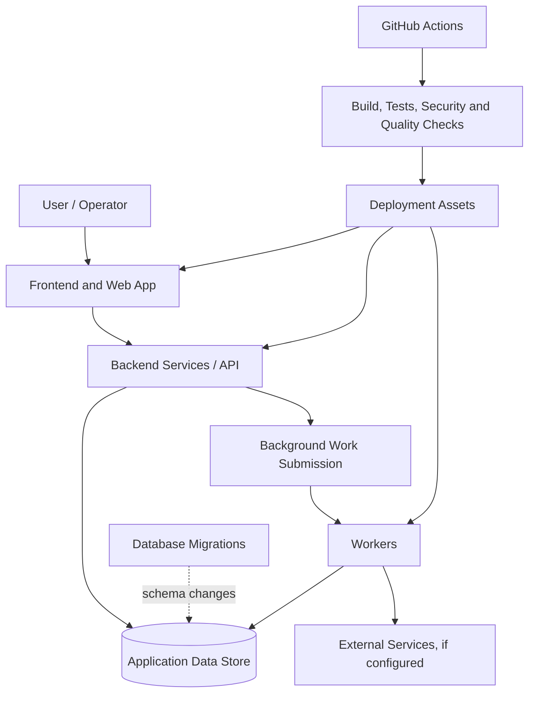

Orchid WebShield
A modular web-security project organized into application interfaces, backend services, background workers, database migrations, deployment assets, and DevSecOps workflows.

Repository · Issues · Actions
Table of Contents
- Overview
- Project Goals
- Architecture
- Repository Structure
- Technology and Runtime Discovery
- Getting Started
- Configuration and Secrets
- Database and Migrations
- Background Workers
- Development Workflow
- DevSecOps and CI/CD
- Security Considerations
- Testing and Quality
- Deployment
- Troubleshooting
- Contributing
- Reporting a Security Issue
- License
Overview
Orchid WebShield is a modular web-security project. Its repository separates user-facing applications, backend code, background workers, database migrations, deployment material, documentation, and DevSecOps configuration. This separation helps keep presentation, application logic, asynchronous processing, data evolution, and delivery automation independently maintainable.
The repository contains the following top-level areas:
- frontend/ and webapp/ — user-facing application code.
- backend/ — server-side application logic and API responsibilities.
- workers/ — background or asynchronous processing components.
- migrations/ — database schema evolution.
- deploy/ — deployment-related assets and configuration.
- devsecops/ and .github/workflows/ — security, quality, and automation workflows.
- docs/ — project documentation.
The exact runtime, supported commands, and implemented security capabilities are defined by the manifests and source files in each component. This README avoids assuming a particular programming language, database, queue, scanner, or deployment provider where that detail cannot be established from the top-level repository structure.
Project Goals
The repository layout supports the following engineering goals:
1. Separation of concerns — UI, server-side logic, asynchronous work, persistence changes, and deployment configuration have distinct locations.
2. Maintainability — components can document their dependencies, configuration, tests, and run commands individually.
3. Repeatable delivery — CI/CD workflows can automate quality gates and deployment steps.
4. Security-aware development — security checks should be reproducible, logged, and integrated into the development lifecycle.
5. Operational clarity — configuration, database changes, background processing, and deployment procedures should be documented rather than assumed.
Feature status: directory names describe repository organization, not proof that a specific feature is complete or enabled. Consult the implementation and tests before claiming that a scanner, detection rule, API endpoint, or protection is production-ready.

Architecture
Conceptual component view

This diagram is a logical view based on the repository's component layout. The actual data store, queue/broker, integrations, service boundaries, and deployment target must be taken from the current configuration and source code; the diagram does not imply that every optional connection is already implemented.
Typical request and job lifecycle
1. A user interacts with a user-facing component in frontend/ or webapp/.
2. The application calls the relevant backend capability.
3. The backend validates the request, enforces authentication/authorization where required, and performs synchronous work.
4. Work that is designed to run asynchronously is handed to the worker mechanism used by the implementation.
5. A worker processes the job and persists or publishes the result using the configured services.
6. Database changes are introduced through reviewed migrations rather than undocumented manual changes.
For each flow, document its real API routes, message schema, persistence model, retry behavior, timeout policy, and failure handling in docs/.
Repository Structure
orchid-webshield/
├── .github/
│   └── workflows/   # GitHub Actions workflows
├── backend/         # Server-side application and API code
├── deploy/          # Deployment-related files
├── devsecops/       # DevSecOps scripts, policies, or configuration
├── docs/            # Architecture and user/developer documentation
├── frontend/        # Frontend code
├── migrations/      # Database schema/data migrations
├── webapp/          # Web application component
├── workers/         # Background processing components
└── README.md
Component responsibilities
Directory	Responsibility	What to document there
.github/workflows/	Repository automation	Workflow triggers, required checks, permissions, artifacts, secrets used
backend/	Server-side behavior	Runtime, dependencies, API routes, authentication, authorization, error handling
deploy/	Deployment configuration	Environments, ports, health checks, resource limits, rollback procedure
devsecops/	Security and delivery automation	Tool versions, scan scope, severity policy, exceptions, report locations
docs/	Project documentation	Architecture decisions, diagrams, setup guides, API contracts, threat model
frontend/	User interface	Build tooling, routes/pages, state management, API integration, UI tests
migrations/	Data model evolution	Migration tool, ordering, rollback constraints, backup considerations
webapp/	Web application code	Whether this is a separate application or the integration layer, and how it runs
workers/	Background tasks	Job types, queue/broker, retry policy, idempotency, concurrency, dead-letter handling

If a directory contains a separate application, it should ideally provide a local README describing its specific runtime, dependencies, test command, configuration variables, and start command.
Technology and Runtime Discovery
Before installing or running the project, inspect the manifests. This repository has multiple components, so one root-level install command may not be appropriate.
From the repository root, use:
find . -maxdepth 4 -type f \
  \( -name 'package.json' \
  -o -name 'pnpm-lock.yaml' \
  -o -name 'yarn.lock' \
  -o -name 'package-lock.json' \
  -o -name 'pyproject.toml' \
  -o -name 'requirements.txt' \
  -o -name 'Pipfile' \
  -o -name 'go.mod' \
  -o -name 'Cargo.toml' \
  -o -name 'composer.json' \
  -o -name 'Dockerfile' \
  -o -name 'compose.yaml' \
  -o -name 'docker-compose.yml' \
  -o -name '.env.example' \) -print
On PowerShell:
Get-ChildItem -Recurse -File -Depth 4 |
  Where-Object {
    $_.Name -in @(
      'package.json', 'pnpm-lock.yaml', 'yarn.lock', 'package-lock.json',
      'pyproject.toml', 'requirements.txt', 'Pipfile', 'go.mod', 'Cargo.toml',
      'composer.json', 'Dockerfile', 'compose.yaml', 'docker-compose.yml', '.env.example'
    )
  } |
  Select-Object -ExpandProperty FullName
Use the package manager and runtime that match each component's manifest and lockfile. Avoid mixing package managers or regenerating lockfiles without an explicit reason.
Getting Started
1. Clone the repository
git clone https://github.com/haytamxp/orchid-webshield.git
cd orchid-webshield
2. Inspect the component instructions
Check for a README.md, package.json, pyproject.toml, requirements.txt, go.mod, Cargo.toml, composer.json, Dockerfile, or compose file inside the component you plan to run. Read its scripts and dependency declarations before executing commands.
For example, for a Node.js component, inspect the available scripts:
cd frontend
cat package.json
Run the package-manager commands declared by that component rather than assuming that npm run dev, npm run start, or another script exists. If the application actually lives under webapp/, use that directory's manifests instead.
3. Configure environment variables
If the repository provides an .env.example, copy it to the component's expected local environment filename and fill in the required values. For example:
cp .env.example .env
This command is only appropriate when .env.example exists at that path. Some components may have their own environment templates. Never commit real credentials, private keys, production tokens, or populated local .env files.
4. Initialize the data store
Identify the configured database and migration tool from the manifests and configuration. Before running migrations:
- point the application at a disposable development database;
- review the migration files and their order;
- take a backup before applying changes to shared or production environments;
- use the migration command documented by the relevant component.
5. Start services
Start required services in the order defined by the implementation, usually backing services first, followed by the backend, workers, and user-facing application. Use a provided compose file or the documented commands for each component if available. The top-level layout alone is not enough to infer the exact startup commands or ports.
Configuration and Secrets
Configuration should be environment-specific and external to source code. Document each supported variable alongside the component that consumes it.
A useful configuration reference should include:
Field	Description to record
Variable name	Exact name as used by the code
Required?	Whether startup fails without it
Default	Safe local default, if one exists
Consumer	Backend, web app, worker, migration, or deployment process
Example	Non-sensitive example value
Secret?	Whether it must be protected and excluded from logs

Common categories to check in the actual manifests and source include application environment, listening address/port, database connection, job broker, external API credentials, session/authentication secrets, CORS origins, logging level, and telemetry endpoints. These are categories to investigate—not a claim that every variable exists in this project.
Security guidelines:
- Keep separate credentials for development, staging, and production.
- Grant database and service accounts only the privileges they need.
- Do not expose server-only secrets through public frontend variables. Frameworks often expose variables with particular prefixes to the browser; verify the framework's rules.
- Never log passwords, access tokens, session cookies, authorization headers, private keys, or sensitive request bodies.
- Rotate secrets that have been committed or exposed; deleting them in a later commit does not remove them from Git history.
- Prefer a supported secret manager or deployment platform secret store for production.
Database and Migrations
The migrations/ directory is the repository's visible location for database migration assets. Confirm which migration engine is used and which application owns each schema.
Recommended practices:
1. Make schema changes through versioned migration files.
2. Keep migrations deterministic and reviewable.
3. Test migrations against a disposable database in CI.
4. Consider backward compatibility when deploying changes while older application instances may still be running.
5. Document destructive changes, data backfills, expected duration, and recovery requirements.
6. Do not assume every migration can be rolled back safely; some data transformations are irreversible.
7. Restrict production migration privileges and record who or what process applied a migration.
Document the actual migration commands and database engine here once confirmed from the codebase.
Background Workers
The workers/ directory indicates a separate location for background processing. A worker system commonly handles work that should not block an HTTP request, but the concrete job types and queue implementation must be confirmed from the source.
For every job type, document:
- input schema and validation rules;
- the source that enqueues the job;
- execution timeout and retry limit;
- idempotency strategy so retries do not duplicate side effects;
- concurrency and resource limits;
- behavior for malformed input and permanent failures;
- how job state and results are recorded;
- monitoring, logging, and alerting;
- handling of secrets and sensitive data.
If workers process user-supplied URLs, files, or network targets, validate them against an explicit allow/deny policy, isolate risky parsing or scanning work, limit resource consumption, and prevent unintended access to internal services. Apply these controls only where relevant to the implemented workloads.
Development Workflow
A recommended workflow for changes is:
1. Create a focused branch from the current default branch.
2. Identify all affected components and their owning manifests.
3. Update or add tests with the implementation.
4. Update API contracts, migration files, configuration reference, and documentation where applicable.
5. Run formatting, linting, unit tests, integration tests, and the security checks defined by the repository.
6. Review dependency and lockfile changes.
7. Open a pull request and ensure required CI checks pass.
8. Deploy to a non-production environment and verify health checks before promoting the same tested artifact.
Keep code changes focused. Avoid introducing credentials, test data containing real user information, or environment-specific assumptions into commits.
DevSecOps and CI/CD
The repository has both .github/workflows/ and devsecops/ directories. Inspect their current contents to determine which checks are already implemented and which are proposals or scripts that still need integration.
A practical security pipeline for a web-security project may include the following controls when supported by the codebase:
Control	Purpose	Recommended gate
Formatting and lint	Keep source consistent and catch common mistakes	Fail on mandatory checks
Unit and integration tests	Verify behavior and regression cases	Fail if required tests fail
Dependency analysis (SCA)	Identify known vulnerable dependencies	Apply documented severity and exploitability policy
Secret scanning	Detect credentials accidentally committed to source	Block confirmed secret exposure
Static analysis (SAST)	Identify patterns associated with code vulnerabilities	Triage findings and block according to policy
Container/IaC scanning	Evaluate container images and deployment configuration, if used	Block policy violations that affect the target environment
Software composition / SBOM	Record shipped components and support response to vulnerable dependencies	Publish a traceable artifact where required
Artifact provenance	Tie the deployed build to the source revision and build process	Promote the same validated artifact

These are recommended controls, not a statement that each one currently runs. Document the actual workflow names, trigger events, tools, severity thresholds, artifacts, and exception process after checking the files under .github/workflows/ and devsecops/.
Security results should be actionable. Record the affected component, rule, severity, evidence, owner, remediation, and any approved time-limited exception. A green pipeline means required checks passed; it does not prove the application has no vulnerabilities.
Security Considerations
Orchid WebShield is a security-oriented project, so security requirements should be designed into each layer rather than treated only as a final scan.
Application and API
- Validate input on the server even when the frontend also validates it.
- Enforce authorization for each sensitive operation and object; authentication alone does not establish permission to access every resource.
- Use parameterized database queries or the framework's safe query builder.
- Apply request-size limits, timeouts, rate limiting, and resource quotas appropriate to the endpoint.
- Use secure session/token handling, CSRF protection where relevant, and an explicit CORS policy.
- Return generic errors to clients while retaining useful, redacted diagnostic information in server logs.
Web and transport security
- Use HTTPS in deployed environments and protect TLS private keys.
- Set security headers appropriate to the application, such as a considered Content Security Policy, X-Content-Type-Options, and a suitable framing policy.
- Avoid unsafe redirects and validate any server-side outbound requests to reduce SSRF risk.
- Treat uploads, URLs, HTML, archives, and other untrusted content as hostile input.
Infrastructure and deployment
- Run services as non-root/non-administrator users where possible.
- Minimize exposed ports and avoid publishing databases or internal brokers directly to the internet.
- Pin and update production dependencies and base images using a documented process.
- Keep logs, backups, build artifacts, and temporary files from exposing secrets or customer data.
- Define health checks, resource limits, backup/restore procedures, and a rollback plan.
- Review access to CI/CD secrets and deployment environments; avoid overly broad workflow permissions.
Authorized use
Any scanning, probing, or security testing functionality should be used only against systems the operator owns or has explicit permission to assess. Establish scope and rate limits, avoid destructive checks on production systems, and protect the reports because they may contain sensitive target details.
Testing and Quality
Use the test commands declared by the relevant project manifests. A component-level test plan should cover, where applicable:
- expected success paths and validation errors;
- authentication and authorization failures;
- cross-user and cross-tenant isolation;
- database migration behavior;
- worker retries, idempotency, timeout, and failure paths;
- API contract compatibility;
- integration boundaries and external-service failures;
- security regressions and authorization bypass attempts;
- deployment health checks and configuration validation.
For security-sensitive behavior, tests should assert side effects as well as HTTP status codes. For example, a rejected update should not modify the database, and a denied export should not leak protected data.
Do not describe a test suite as comprehensive solely because code coverage is high. Track uncovered security requirements and critical execution paths separately.
Deployment
Deployment assets live under deploy/, but the actual target and commands must be established from those files and the CI/CD workflows.
Before deploying to a shared or production environment:
- verify the target environment and release revision;
- confirm required configuration and secrets are present;
- review pending database migrations and backup status;
- ensure required security and test gates passed;
- use least-privilege service identities;
- confirm logs, metrics, health checks, and alerts are enabled;
- plan rollback and check whether migrations are backward-compatible;
- verify the service after deployment and record the release identifier.
Avoid storing production credentials or real secrets in deployment files committed to the repository. Prefer environment-specific configuration and a managed secret store.
Troubleshooting
Because the project contains multiple components, investigate failures at the boundary where they occur.
Symptom	First checks
A component does not start	Read its manifest, startup command, runtime version, and application logs
Missing configuration error	Compare required variables in source/configuration with the correct environment template; do not paste secrets into issues
Database connection fails	Check host/port, credentials, network reachability, database availability, and migration state
Worker does not process jobs	Check worker process health, broker configuration if used, job payload validation, retries, and logs
Frontend cannot reach backend	Verify API base URL, CORS, DNS, ports, TLS, and reverse-proxy configuration
CI fails	Open the failed workflow step, reproduce the command locally where possible, and inspect lockfile/runtime drift
Security scan blocks a change	Validate the finding and affected code, record evidence, fix the root cause, or use the documented exception process
A migration fails	Stop repeated attempts, inspect the migration state and error, preserve data, and follow the documented recovery plan

When reporting a bug, include the component, commit SHA, environment (with secrets removed), reproduction steps, expected behavior, actual behavior, and relevant redacted logs.
Contributing
Contributions should be small, reviewable, tested, and documented.
1. Open an issue or discussion for substantial changes so the scope can be agreed.
2. Create a topic branch.
3. Follow the formatting and testing conventions of the affected component.
4. Add regression tests for fixes, particularly security fixes.
5. Update docs and configuration references for user-visible behavior or new settings.
6. Never commit secrets, private customer data, or generated artifacts that do not belong in source control.
7. Submit a pull request with a clear summary, test evidence, impact, and migration/deployment notes.
Reporting a Security Issue
Please do not publish exploitable details, credentials, or sensitive target information in a public issue. Use a private vulnerability-reporting channel configured for this repository, if one is available. If no private reporting channel is configured, contact the maintainer privately before disclosing details publicly.
A useful report should include:
- affected commit, component, or deployment;
- impact and realistic attack prerequisites;
- minimal reproduction steps in an authorized environment;
- logs or proof-of-concept evidence with secrets and personal data redacted;
- suggested mitigation, if known.
Security reports should focus on reproducible behavior and impact. Do not test systems belonging to other people without explicit authorization.
License
Review the repository's LICENSE file before using, modifying, or redistributing this project. If no license file is present, the project should not be assumed to be open source or freely redistributable.
Documentation References
These references provide background for security controls that may be relevant to this project; they do not imply that the repository has implemented every control described.
- OWASP Top 10
- OWASP Application Security Verification Standard (ASVS)
- OWASP Cheat Sheet Series
- NIST Secure Software Development Framework (SSDF), SP 800-218
- GitHub Actions documentation
