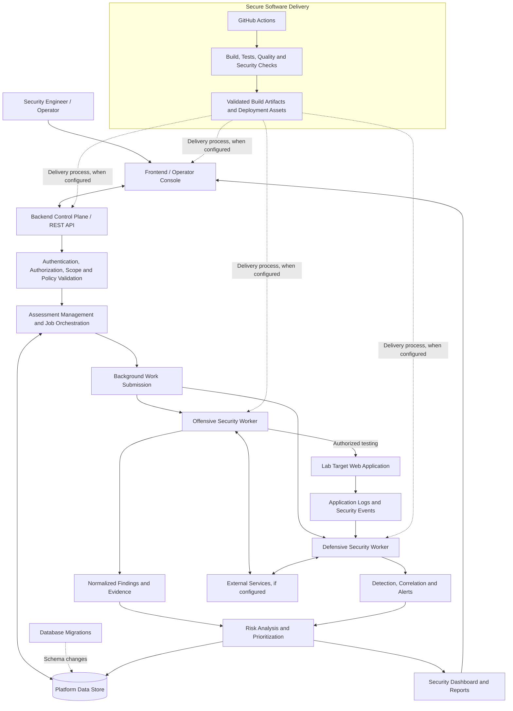

# Orchid WebShield
### Modular Web Application Security Assessment & Defense Platform

**Orchid WebShield** is a cybersecurity platform designed to integrate authorized offensive security assessments, defensive monitoring, application security validation, and DevSecOps practices into a unified architecture.

Its purpose is to help security engineers identify web application vulnerabilities, detect suspicious activity, correlate security events, prioritize risks, and verify remediation through repeatable security assessments and automated quality checks.

WebShield combines offensive and defensive security workflows with a central control plane responsible for coordinating assessments, validating authorization and scope, managing findings, and supporting security reporting.

## Project Objectives

- **Assess web application security:** Evaluate HTTP endpoints, APIs, authentication, authorization, and input validation within an explicitly authorized scope.
- **Detect suspicious activity:** Process application security events and identify potentially malicious behaviors through detection rules and event correlation.
- **Centralize security findings:** Normalize assessment results and defensive alerts into consistent structures containing evidence, severity, impact, and remediation guidance.
- **Prioritize risks:** Correlate findings and relevant security events to help engineers understand potential impact and remediation priorities.
- **Coordinate security operations:** Manage targets, assessment workflows, background jobs, and interactions between platform components through a central API.
- **Strengthen the development lifecycle:** Integrate build validation, automated testing, static analysis, dependency vulnerability checks, and secret detection into CI/CD workflows.
- **Validate remediation:** Support repeatable assessments and security regression testing to determine whether identified weaknesses have been addressed.

## Architecture

WebShield follows a modular architecture that separates the control plane, security workers, target application, data management, and secure software delivery.

The control plane coordinates authorized operations. Offensive workers evaluate the target application, while defensive workers process security events and generate detections. Their results feed the platform's findings, risk-analysis, and reporting processes.

### Logical Architecture — Mermaid

*The diagram represents the intended logical architecture. Individual integrations and deployment paths depend on their implementation and configuration.*

## Core Components

### 1. Control Plane — Backend API

The control plane provides the central coordination layer for WebShield.

Its responsibilities include authentication and authorization, target management, scope validation, assessment orchestration, job coordination, findings management, risk analysis, auditing, and reporting.

Security-sensitive operations should be validated against authorization, target scope, and applicable policy before they are dispatched to a worker. Workers should not be exposed directly to the frontend.

### 2. Offensive Security Engine

The offensive engine is designed as a collection of specialized modules that conduct controlled security assessments against authorized targets.

Its testing domains include:

- HTTP and API security.
- Authentication and session management.
- Authorization and access-control enforcement.
- Input-validation weaknesses.
- Attack-surface discovery.
- Evidence collection and remediation verification.

Assessment results are intended to be normalized into actionable findings that can be reviewed, prioritized, and retested.

### 3. Defensive Security Engine

The defensive engine is responsible for turning application telemetry and security events into useful detection outcomes.

Its architectural responsibilities include:

- Security-event ingestion and validation.
- Event normalization.
- Rule-based detection.
- Correlation of related events.
- Alert generation and incident-oriented evidence.
- Detection and investigation metrics.

This enables WebShield to connect observed security activity with assessment results and remediation efforts.

### 4. Lab Target Web Application

The target web application provides a controlled environment for testing web security weaknesses and validating defensive behavior.

It supports application-security scenarios involving authentication, sessions, authorization, data handling, and security-event logging. It is treated as the system under assessment rather than as part of the control plane.

### 5. Data, Risk and Reporting

WebShield is designed to organize the information needed to understand security outcomes, including:

- Targets and assessments.
- Jobs and execution results.
- Findings and evidence.
- Security events and alerts.
- Risk and remediation information.
- Audit records and reports.

Data contracts and consistent event formats help maintain interoperability between the platform, the offensive engine, the defensive engine, and the target application.

### 6. DevSecOps and Secure Delivery

The DevSecOps layer applies automated validation to changes made to the platform.

Its security gates cover software quality, formatting, automated tests, compilation, static security analysis, dependency vulnerability analysis, and secret detection.

The goal is to identify defects early and provide repeatable evidence that configured checks have passed. Deployment automation and release procedures are separate concerns and should be integrated through explicit, validated delivery workflows.

## Technology Stack

| Technology | Purpose |
|---|---|
| **Go** | Backend services, API foundations, and security tooling |
| **SQLite** | Local persistence for the lab target application |
| **Git and GitHub** | Source control and collaborative development |
| **GitHub Actions** | Continuous integration and automated validation |
| **Gosec** | Static security analysis for Go |
| **govulncheck** | Analysis of Go code and dependencies for known vulnerabilities |
| **Gitleaks** | Detection of potentially exposed secrets in source control |

The modular architecture allows individual services and workers to be developed, tested, and integrated according to their responsibilities, without unnecessarily coupling the application under test to the central control plane.

## Security Principles

WebShield is designed around the following principles:

- **Explicit authorization:** Offensive operations must remain within an approved assessment scope.
- **Least privilege:** Components should receive only the permissions needed to perform their functions.
- **Defense in depth:** Application controls, security monitoring, code analysis, and dependency checks provide complementary protection.
- **Separation of concerns:** The API, target application, offensive engine, and defensive engine have distinct responsibilities.
- **Evidence-based findings:** Security results should include relevant evidence, context, impact, and actionable remediation.
- **Fail-closed policy enforcement:** Security-sensitive operations should be rejected when required authorization or scope checks cannot be verified.
- **Repeatable validation:** Security improvements should be retested, and automated checks should be reproducible.

## Intended Outcome

Orchid WebShield aims to provide a unified engineering platform in which security testing, defensive detection, risk prioritization, and remediation validation reinforce one another.

By integrating offensive and defensive workflows with a central control plane and automated DevSecOps checks, the project seeks to make web application security assessments more structured, traceable, and repeatable.

## Responsible Use

WebShield is intended for authorized security testing and controlled laboratory environments. Offensive modules must be used only against systems that the operator owns or is explicitly authorized to assess. Testing scope, operational impact, collected evidence, and access credentials must be handled responsibly.

A successful automated check is evidence that the corresponding configured validation completed successfully; it is not proof that an application is entirely secure.
